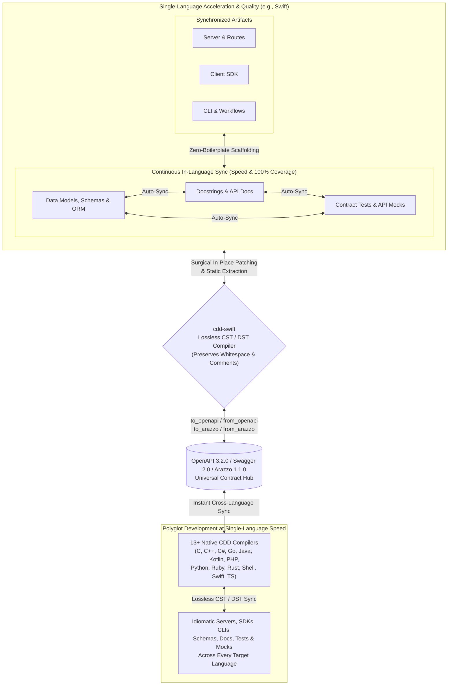

cdd-swift: Swift ⇄ OpenAPI
==========================

[](https://opensource.org/licenses/Apache-2.0)
[](https://offscale.io/wasm_web_demo)
[](https://github.com/SamuelMarks/cdd-swift/actions)
[](#)
[](#)

**cdd-swift** compiles **[OpenAPI](https://spec.openapis.org/oas/latest.html) / [Swagger](https://spec.openapis.org/oas/v2.0.html) / [Arazzo](https://spec.openapis.org/arazzo/latest.html)** to and from **Swift** (servers, client SDKs, CLIs, database schemas, tests, mocks, and docs), updating your existing code in-place without overwriting your edits.

**Compiler Driven Development (CDD)** is a software engineering methodology that uses a suite of standalone, lossless compilers to synchronize API specifications, server implementations, client SDKs, command-line tooling, workflow orchestrators, tests, and documentation.

Unlike traditional code generators that treat outputs as disposable or read-only, Compiler Driven Development provides a **complete, standalone compiler** (exposed as both a CLI and a programmatic SDK) written natively in each supported language. Where conventional compilers rely solely on an Abstract Syntax Tree (AST) that discards formatting and comments, CDD compilers operate on a **Concrete Syntax Tree (CST)** or **Decorated Syntax Tree (DST)**. This guarantees **lossless conversion**—preserving exact whitespace, indentation, inline comments, block comments, and docstrings—allowing true bidirectional synchronization between hand-edited `Swift` source code and [OpenAPI 3.2.0](https://spec.openapis.org/oas/v3.2.0.html), [Swagger 2.0](https://spec.openapis.org/oas/v2.0.html), and [Arazzo 1.1.0](https://spec.openapis.org/arazzo/v1.1.0.html) specifications.

---

## Why Compiler Driven Development?

By replacing one-way templates and manual boilerplate with lossless CST/DST compilers, Compiler Driven Development transforms the engineering lifecycle across four dimensions:

- **Development Speed**: Eliminate manual boilerplate across servers, client SDKs, CLIs, database models, workflow runners, and mock servers. Start from an [OpenAPI](https://spec.openapis.org/oas/latest.html) or [Arazzo](https://spec.openapis.org/arazzo/latest.html) specification to scaffold an entire installable project (complete with package manifests and CI workflows), or write code first in `Swift` and extract the specification automatically. When requirements change, update whichever representation is most convenient and synchronize the rest immediately.
- **Development Consistency**: Every data model, route handler, CLI flag, ORM entity, workflow step, and API contract is derived from and validated against the same semantic representation. Architectural drift between backend routes, frontend clients, and published specifications becomes structurally impossible.
- **Development Quality**: Keeping tests and documentation in lockstep with implementation code is automated rather than an afterthought. Because the compiler parses and emits docstrings, type signatures, API mocks, and contract test suites alongside your business logic, maintaining **100% documentation coverage and 100% test coverage** becomes a natural byproduct of compilation rather than a manual chore.
- **Polyglot Development**: Seamlessly bridge **13+ programming languages** (C, C++, C#, Go, Java, Kotlin, PHP, Python, Ruby, Rust, POSIX Shell, Swift, and TypeScript) to and from [OpenAPI](https://spec.openapis.org/oas/latest.html) and [Arazzo](https://spec.openapis.org/arazzo/latest.html) specifications. Any codebase in any supported language can be reverse-compiled into OpenAPI/Arazzo and immediately compiled forward into idiomatic, human-editable code across every other language in the suite. And being an open-source methodology—rather than a proprietary trade secret—new languages can be added by implementing new compilers that follow the CDD approach (see [cdd-spec-conformance](https://github.com/SamuelMarks/cdd-spec-conformance) for tooling to facilitate).

---

## The Standalone Compiler Architecture and Lossless Conversion

Traditional code generation tools rely on destructive templating: if you regenerate your project from an updated specification, your custom implementation logic, formatting, and comments are overwritten.

Each Compiler Driven Development toolchain is written natively in its target language, compiles both to native binaries and to **WebAssembly (WASM/WASI)**, and implements a full lexer, parser, semantic differ, and code emitter backed by Concrete Syntax Tree (CST) and Decorated Syntax Tree (DST) representations:

- **Beyond AST to CST/DST**: A standard Abstract Syntax Tree (AST) captures program semantics while stripping away "trivia" (whitespace, blank lines, and comments). By pairing structural AST semantics with a Concrete Syntax Tree (CST) or Decorated Syntax Tree (DST) that attaches trivia and structured documentation directly to syntax nodes, the compiler preserves 100% of your source formatting and comments.
- **Zero-Destruction Guarantee**: Every part of the generated codebase is designed to be edited by humans. You can open generated routing files, data models, database entities, workflow runners, tests, and CLI commands, format them to your preferences, add inline comments, and inject custom business logic.
- **When your specification changes**: The CDD compiler parses your existing source files into a CST/DST, computes a semantic diff against the updated [OpenAPI](https://spec.openapis.org/oas/latest.html) or [Arazzo](https://spec.openapis.org/arazzo/latest.html) specification, and surgically patches in new endpoints, workflows, parameters, or fields without disturbing your custom logic, comments, or whitespace.
- **When your codebase changes**: The compiler statically analyzes your updated source code, routes, workflows, tests, and docstrings—without unsafe dynamic code execution or reflection—to extract a 100% compliant, authoritative [OpenAPI](https://spec.openapis.org/oas/latest.html) or [Arazzo](https://spec.openapis.org/arazzo/latest.html) specification.

---

## The Bidirectional Synchronization Loop



The Compiler Driven Development lifecycle delivers compounding returns in both single-language and polyglot environments:
1. **Single-Language Speed**: Edit whichever artifact is most convenient—models/schemas, route handlers, docstrings, or tests—and let `cdd-swift` surgically synchronize the rest in-place without overwriting your custom logic, comments, or whitespace.
2. **Single-Language Quality**: Because schemas, documentation, contract tests, and mocks are continuously cross-compiled rather than manually maintained, **100% doc coverage and 100% test coverage** are enforced automatically on every sync.
3. **Polyglot Development at Single-Language Speed**: Extracting an authoritative [OpenAPI](https://spec.openapis.org/oas/latest.html) or [Arazzo](https://spec.openapis.org/arazzo/latest.html) contract from one language immediately drives lossless forward-compilation across all 13+ supported languages—making multi-language SDK, CLI, and service maintenance just as fast as working in a single codebase.

---

## Core Capabilities Shared Across All CDD Compilers

Every `cdd-*` repository in the suite implements the same foundational feature set:

- **Bidirectional OpenAPI 3.2.0 & Swagger 2.0 Compilation**:
  - `from_openapi`: Generate idiomatic `Swift` Client SDKs (`to_sdk`), Client CLIs (`to_sdk_cli`), and Server stubs/routers (`to_server`) from a single specification (`-i`) or a batch directory of specifications (`--input-dir`). Automatically upgrades legacy Swagger 2.0 and OpenAPI 3.0/3.1 specifications to OpenAPI 3.2.0.
  - `to_openapi`: Statically parse existing `Swift` source files or directories to extract a compliant OpenAPI 3.2.0 specification.
- **Bidirectional Arazzo 1.1.0 Workflow Orchestration**:
  - `from_arazzo`: Compile multi-step [Arazzo 1.1.0](https://spec.openapis.org/arazzo/v1.1.0.html) workflow specifications (including runtime expressions, step DAGs, criterion evaluations, and failure/success actions) into `Swift` SDK workflow orchestrators (`to_sdk`), CLI workflow runners (`to_sdk_cli`), and Server/E2E workflow test suites (`to_server`).
  - `to_arazzo`: Reverse-parse `Swift` workflow orchestrators, CLI scripts, or E2E test suites back into an authoritative Arazzo 1.1.0 document.
- **In-Place Codebase Synchronization (`sync`)**:
  - Synchronize data models, ORM schemas, route handlers, docstrings, contract tests, mocks, and specifications in-place using lossless CST/DST patching.
- **Documentation Code-Snippet Generation (`to_docs_json`)**:
  - Emit a structured JSON documentation payload containing idiomatic `Swift` request/workflow code snippets for every operation in an OpenAPI specification (with `--no-imports` and `--no-wrapping` options for embedding in documentation portals).
- **Composable Contract Tests, Mocks, CI, and Package Scaffolding**:
  - By default, `from_openapi` and `from_arazzo` scaffold complete, installable `Swift` packages and `.github/workflows/ci.yml` pipelines (configurable via `--no-installable-package` and `--no-github-actions`), and generate contract test suites and API mocks/fakes via `--tests`.
- **Model Context Protocol (`mcp`) & JSON-RPC (`serve_json_rpc`)**:
  - Run `cdd-swift mcp` to expose the compiler over stdio as an [MCP](https://modelcontextprotocol.io/) server for AI assistants and IDEs, or pass `--mcp` during generation to emit MCP tool/resource adapters directly inside generated SDKs and servers.
  - Run `cdd-swift serve_json_rpc` to expose the compiler's full API over JSON-RPC 2.0 (`--port`, `--listen`).
- **Native CLI, Programmatic SDK, and WebAssembly (WASM/WASI)**:
  - Use `cdd-swift` from the command line, import its programmatic SDK directly into `Swift` applications, or run it in the browser and WASI runtimes via its WebAssembly build (see [WASM.md](WASM.md)).

---

## The Global Polyglot Ecosystem

Every supported language operates on the same core Compiler Driven Development principles and is powered by a dedicated, native compiler tailored to that language's syntax tree, idioms, and package manager.

All implementations expose a standardized command-line interface (`cdd-swift <subcommand>`) and programmatic SDK.

| Repository | Language | Targets (`to_sdk`; `to_sdk_cli`; `to_server`) | Special Features Beyond Common Subset | Standards | CI Status |
|---|---|---|---|---|---|
| [`cdd-c`](https://github.com/SamuelMarks/cdd-c) | C (C89) | Client; Client CLI; Server | 42-Language FFI Generator (`bind`); GNU-to-C89 AST Lowering; Safe CRT & Memory Security Auditor; `c-orm` Migrations | [Arazzo 1.1.0](https://spec.openapis.org/arazzo/v1.1.0.html); [Swagger 2.0](https://spec.openapis.org/oas/v2.0.html); [OpenAPI 3.2.0](https://spec.openapis.org/oas/v3.2.0.html); [MCP](https://modelcontextprotocol.io/) | [](https://github.com/SamuelMarks/cdd-c/actions/workflows/ci.yml) |
| [`cdd-cpp`](https://github.com/SamuelMarks/cdd-cpp) | C++ | Client; Client CLI; Server | [Google Discovery](https://developers.google.com/discovery) (`from_google_discovery`); PostgreSQL `libpq` ORM & Faker Support | [Google Discovery](https://developers.google.com/discovery); [Arazzo 1.1.0](https://spec.openapis.org/arazzo/v1.1.0.html); [Swagger 2.0](https://spec.openapis.org/oas/v2.0.html); [OpenAPI 3.2.0](https://spec.openapis.org/oas/v3.2.0.html); [MCP](https://modelcontextprotocol.io/) | [](https://github.com/SamuelMarks/cdd-cpp/actions/workflows/ci.yml) |
| [`cdd-csharp`](https://github.com/SamuelMarks/cdd-csharp) | C# | Client; Client CLI; Server | CLR & Roslyn CST/DST Trivia-Preserving Sync; Entity Framework & Minimal API Targets | [Arazzo 1.1.0](https://spec.openapis.org/arazzo/v1.1.0.html); [Swagger 2.0](https://spec.openapis.org/oas/v2.0.html); [OpenAPI 3.2.0](https://spec.openapis.org/oas/v3.2.0.html); [MCP](https://modelcontextprotocol.io/) | [](https://github.com/SamuelMarks/cdd-csharp/actions/workflows/ci.yml) |
| [`cdd-go`](https://github.com/SamuelMarks/cdd-go) | Go | Client; Client CLI; Server | Go `dst`/`ast` Surgical Patching; Multi-Source Truth Sync (`code` ⇄ `openapi`) | [Arazzo 1.1.0](https://spec.openapis.org/arazzo/v1.1.0.html); [Swagger 2.0](https://spec.openapis.org/oas/v2.0.html); [OpenAPI 3.2.0](https://spec.openapis.org/oas/v3.2.0.html); [MCP](https://modelcontextprotocol.io/) | [](https://github.com/SamuelMarks/cdd-go/actions/workflows/ci.yml) |
| [`cdd-java`](https://github.com/SamuelMarks/cdd-java) | Java | Client; Client CLI; Server | JavaParser CST Lexical Preservation; WASI JSON-RPC Mode; In-Memory Compiler Pipeline | [Arazzo 1.1.0](https://spec.openapis.org/arazzo/v1.1.0.html); [Swagger 2.0](https://spec.openapis.org/oas/v2.0.html); [OpenAPI 3.2.0](https://spec.openapis.org/oas/v3.2.0.html); [MCP](https://modelcontextprotocol.io/) | [](https://github.com/SamuelMarks/cdd-java/actions/workflows/ci.yml) |
| [`cdd-kotlin`](https://github.com/offscale/cdd-kotlin) | Kotlin (Ktor Multiplatform) | Client; Client CLI; Server | Multiplatform Auto-Admin UI; Ephemeral & Seeded Mock Server Modes; Webhook Triggers | [Arazzo 1.1.0](https://spec.openapis.org/arazzo/v1.1.0.html); [Swagger 2.0](https://spec.openapis.org/oas/v2.0.html); [OpenAPI 3.2.0](https://spec.openapis.org/oas/v3.2.0.html); [MCP](https://modelcontextprotocol.io/) | [](https://github.com/offscale/cdd-kotlin/actions/workflows/ci.yml) |
| [`cdd-php`](https://github.com/SamuelMarks/cdd-php) | PHP | Client; Client CLI; Server | Multi-Tiered DAO (`StubDao` / `ConcreteDao`); Ephemeral & Faker-Seeded SQLite Server Modes | [Arazzo 1.1.0](https://spec.openapis.org/arazzo/v1.1.0.html); [Swagger 2.0](https://spec.openapis.org/oas/v2.0.html); [OpenAPI 3.2.0](https://spec.openapis.org/oas/v3.2.0.html); [MCP](https://modelcontextprotocol.io/) | [](https://github.com/SamuelMarks/cdd-php/actions/workflows/ci.yml) |
| [`cdd-python`](https://github.com/offscale/cdd-python) | Python | N/A (server building blocks) | CLI ⇄ SQLAlchemy ⇄ Pydantic ⇄ Docs ⇄ JSON Schema | N/A | [](https://github.com/offscale/cdd-python/actions) |
| [`cdd-python-all`](https://github.com/offscale/cdd-python-all) | Python | Client; Client CLI; Server | `LibCST` Lossless Sync; Multi-Truth Sync (`class`, `sqlalchemy`, `function`, `openapi`); FastAPI + SQLAlchemy | [Arazzo 1.1.0](https://spec.openapis.org/arazzo/v1.1.0.html); [Swagger 2.0](https://spec.openapis.org/oas/v2.0.html); [OpenAPI 3.2.0](https://spec.openapis.org/oas/v3.2.0.html); [MCP](https://modelcontextprotocol.io/) | [](https://github.com/offscale/cdd-python-all/actions/workflows/ci.yml) |
| [`cdd-ruby`](https://github.com/SamuelMarks/cdd-ruby) | Ruby | Client; Client CLI; Server | ActiveRecord Sync (`class`, `activerecord`, `function`); Ephemeral & Seeded Server Generation | [Arazzo 1.1.0](https://spec.openapis.org/arazzo/v1.1.0.html); [Swagger 2.0](https://spec.openapis.org/oas/v2.0.html); [OpenAPI 3.2.0](https://spec.openapis.org/oas/v3.2.0.html); [MCP](https://modelcontextprotocol.io/) | [](https://github.com/SamuelMarks/cdd-ruby/actions/workflows/ci.yml) |
| [`cdd-rust`](https://github.com/SamuelMarks/cdd-rust) | Rust | Client; Client CLI; Server | Actix-Web, Axum & Reqwest Targets; Diesel Schema Sync; Standalone `schema-gen`, `scaffold` & `test-gen` | [Arazzo 1.1.0](https://spec.openapis.org/arazzo/v1.1.0.html); [Swagger 2.0](https://spec.openapis.org/oas/v2.0.html); [OpenAPI 3.2.0](https://spec.openapis.org/oas/v3.2.0.html); [MCP](https://modelcontextprotocol.io/) | [](https://github.com/SamuelMarks/cdd-rust/actions/workflows/ci.yml) |
| [`cdd-sh`](https://github.com/SamuelMarks/cdd-sh) | Shell (`/bin/sh`) | Client; Client CLI; Server | Zero-Dependency Embedded `sh`/`jq`/`awk` Cross-Platform Binary; Direct AST `parse` & `emit` Subcommands | [Arazzo 1.1.0](https://spec.openapis.org/arazzo/v1.1.0.html); [Swagger 2.0](https://spec.openapis.org/oas/v2.0.html); [OpenAPI 3.2.0](https://spec.openapis.org/oas/v3.2.0.html); [MCP](https://modelcontextprotocol.io/) | [](https://github.com/SamuelMarks/cdd-sh/actions/workflows/ci.yml) |
| [`cdd-swift`](https://github.com/SamuelMarks/cdd-swift) | Swift | Client; Client CLI; Server | `SwiftSyntax` Lossless Merging (`merge_swift`); Vapor + Fluent ORM Scaffolding; `sync_arazzo` | [Arazzo 1.1.0](https://spec.openapis.org/arazzo/v1.1.0.html); [Swagger 2.0](https://spec.openapis.org/oas/v2.0.html); [OpenAPI 3.2.0](https://spec.openapis.org/oas/v3.2.0.html); [MCP](https://modelcontextprotocol.io/) | [](https://github.com/SamuelMarks/cdd-swift/actions/workflows/ci.yml) |
| [`cdd-ts`](https://github.com/offscale/cdd-ts) | TypeScript | Client; Client CLI; Server | Auto-Admin UI; Angular, React, Vue, Vanilla; Fetch, Axios, Node; Express, Bun, Deno; TypeORM Sync | [Arazzo 1.1.0](https://spec.openapis.org/arazzo/v1.1.0.html); [Swagger 2.0](https://spec.openapis.org/oas/v2.0.html); [OpenAPI 3.2.0](https://spec.openapis.org/oas/v3.2.0.html); [MCP](https://modelcontextprotocol.io/) | [](https://github.com/offscale/cdd-ts/actions/workflows/ci.yml) |

---

## Programmatic SDK & CLI Quickstart

Every `cdd-*` toolchain can be invoked either as a standalone CLI binary or imported as a native `Swift` library.

### Minimal CLI Usage

```sh
# Print help and version
cdd-swift --help
cdd-swift --version

# Generate a Swift Client SDK, Client CLI, or Server from an OpenAPI spec
cdd-swift from_openapi to_sdk -i spec.json -o ./sdk --tests
cdd-swift from_openapi to_sdk_cli -i spec.json -o ./cli --tests
cdd-swift from_openapi to_server -i spec.json -o ./server --tests

# Extract an OpenAPI 3.2.0 spec from existing Swift source code
cdd-swift to_openapi -i ./src -o openapi.json

# Generate and extract Arazzo 1.1.0 multi-step workflows
cdd-swift from_arazzo to_sdk -i workflow.arazzo.json -o ./workflows --tests
cdd-swift from_arazzo to_sdk_cli -i workflow.arazzo.json -o ./workflow-cli --tests
cdd-swift from_arazzo to_server -i workflow.arazzo.json -o ./workflow-server --tests
cdd-swift to_arazzo -i ./workflows -o extracted.arazzo.json

# Synchronize codebase models, routes, tests, docs, and OpenAPI in-place
cdd-swift sync -i ./src -o openapi.json

# Generate documentation-ready Swift code snippets JSON for an OpenAPI spec
cdd-swift to_docs_json --no-imports --no-wrapping -i spec.json -o docs.json

# Run as a Model Context Protocol (MCP) server over stdio or JSON-RPC 2.0 server
cdd-swift mcp
cdd-swift serve_json_rpc --port 8080 --listen 127.0.0.1
```

### Programmatic SDK Example

```swift
import CDDSwift
import Foundation

// 1. Construct or parse an OpenAPI 3.2.0 specification into the CDDSwift AST/IR
let specJSON = try OpenAPIDocumentBuilder(title: "Petstore API", version: "1.0.0")
    .addSchema("Pet", schema: Schema(
        type: "object",
        properties: [
            "id": Schema(type: "integer"),
            "name": Schema(type: "string")
        ],
        required: ["id", "name"]
    ))
    .addPath("/pets", item: PathItem(
        get: Operation(
            summary: "List all pets",
            operationId: "listPets",
            responses: [
                "200": Response(
                    description: "A list of pets",
                    content: ["application/json": MediaType(schema: Schema(type: "array", items: SchemaItem(ref: "#/components/schemas/Pet")))]
                )
            ]
        )
    ))
    .serialize()

let document: OpenAPIDocument = try OpenAPIParser.parse(json: specJSON)

// 2. Emit Swift Client SDK, ArgumentParser CLI, Vapor/Fluent Server, and Docs JSON
let sdkFiles: [String: String] = OpenAPIToSwiftGenerator.generateFiles(from: document, tests: true)
let cliSource: String = emitCliCode(document: document)
let serverFiles: [String: String] = emitServerFiles(document: document, testsMocks: true)
let docsJson: String = DocsJsonGenerator.generate(from: document, includeImports: false, includeWrapping: false)

// 3. Losslessly merge regenerated Swift declarations into existing source via SwiftSyntax CST
let existingSwift = """
import Foundation

// Custom developer comment preserved across regeneration
public struct Pet: Codable, Equatable {
    public let id: Int
}
"""
let generatedSwift = OpenAPIToSwiftGenerator.generate(from: document)
let mergedSwift: String = SwiftCodeMerger.merge(generatedCode: generatedSwift, into: existingSwift)

// 4. Reverse-parse Swift source code back into an authoritative OpenAPIDocument
let extractedDoc: OpenAPIDocument = try SwiftASTParser().parseDocument(from: mergedSwift)

// 5. Build, emit, and reverse-parse Arazzo 1.1.0 multi-step workflows
let arazzoJSON = try ArazzoDocumentBuilder(title: "Pet Adoption Workflow", version: "1.0.0")
    .addSourceDescription(name: "petstore", url: "./openapi.json", type: .openapi)
    .addWorkflow(ArazzoWorkflow(
        workflowId: "adoptPet",
        summary: "Select and adopt a pet",
        steps: [
            ArazzoStep(
                stepId: "fetchPets",
                operationId: "listPets",
                successCriteria: [ArazzoCriterion(context: "$statusCode", condition: "== 200")]
            )
        ]
    ))
    .serialize()

let arazzoSpec: ArazzoSpecification = try ArazzoEmitter.parse(json: arazzoJSON)
let workflowClientCode: String = ArazzoSdkEmitter.emitWorkflowClient(from: arazzoSpec)
let roundtrippedArazzo: ArazzoSpecification = try SwiftASTArazzoParser().parseSpecification(from: workflowClientCode)
```

### Installation & Development

All `cdd-*` repositories support both native language build tools and a standardized cross-platform `Makefile` / `make.bat` interface (`deps`, `build`, `test`):

```sh
make deps
make build
make test
# or on Windows:
.\make.bat deps
.\make.bat build
.\make.bat test
```

Add `CDDSwift` as a dependency in your `Package.swift`:

```swift
dependencies: [
    .package(url: "https://github.com/SamuelMarks/cdd-swift.git", from: "0.0.4")
],
targets: [
    .target(
        name: "YourTarget",
        dependencies: [
            .product(name: "CDDSwift", package: "cdd-swift")
        ]
    )
]
```

Or build, test, and run directly with the Swift Package Manager (Swift 6.0+):

```sh
# Resolve dependencies and build release binary
swift package resolve
swift build -c release

# Run unit and integration test suites with code coverage
swift test --enable-code-coverage

# Generate DocC API documentation, WebAssembly (WASI) binary, or Docker images
make docs
make build_wasm
make build_docker
```

> **Further Documentation**:
> - [**ARCHITECTURE.md**](ARCHITECTURE.md) — Compiler pipeline (Lexer → CST/DST/AST → Semantic Diff → Emitter).
> - [**COMPLIANCE.md**](COMPLIANCE.md) — Swagger 2.0, OpenAPI 3.2.0, Arazzo 1.1.0, and MCP support matrices.
> - [**USAGE.md**](USAGE.md) — Detailed CLI, SDK, ORM, and roundtrip usage guide.
> - [**DEVELOPING.md**](DEVELOPING.md) — Local development, linting, testing, and coverage guide.
> - [**WASM.md**](WASM.md) — WebAssembly / WASI build and browser/Node.js execution instructions.
> - [**PUBLISH.md**](PUBLISH.md) — Package publishing and release workflow.

---

## Universal CLI Toolchain

Once you learn the Compiler Driven Development CLI in one language, you can use the exact same commands, flags, and environment variables across the entire polyglot stack.

### Common Arguments & Environment Variables

| Flag | Short | Environment Variable | Description |
|---|---|---|---|
| `--help` | `-h` | — | Print help information for the CLI or subcommand. |
| `--version` | `-v` / `-V` | — | Print version information. |
| `--input <path>` | `-i` / `-f` | `CDD_INPUT` | Path or URL to the input OpenAPI/Arazzo spec or source file/directory. |
| `--input-dir <dir>` | `-d` | `CDD_INPUT_DIR` | Directory containing multiple OpenAPI/Arazzo specifications for batch generation. |
| `--output <path>` | `-o` | `CDD_OUTPUT` | Destination file or directory path for generated code or extracted specifications. |
| `--tests` | `-t` | `CDD_TESTS` | Generate composable contract/integration tests and API mocks alongside code. |
| `--mcp` | `-m` | `CDD_MCP` | Generate Model Context Protocol (MCP) server and client adapters. |
| `--no-github-actions` | — | `CDD_NO_GITHUB_ACTIONS` | Do not generate `.github/workflows/ci.yml` scaffolding in target output. |
| `--no-installable-package` | — | `CDD_NO_INSTALLABLE_PACKAGE` | Do not generate package manifest/build files in target output. |
| `--no-imports` | — | `CDD_NO_IMPORTS` | (`to_docs_json`) Omit import/include statements from generated documentation snippets. |
| `--no-wrapping` | — | `CDD_NO_WRAPPING` | (`to_docs_json`) Omit boilerplate wrapper functions/classes from documentation snippets. |
| `--port <port>` | `-p` | `CDD_PORT` | (`serve_json_rpc`) TCP port to listen on (default: `8080`). |
| `--listen <addr>` | `-l` | `CDD_LISTEN` | (`serve_json_rpc`) Host/IP address to bind to (default: `127.0.0.1`). |
| `--truth <source>` | `-t` | `CDD_TRUTH` | (`sync`) Designate the single source of truth when synchronizing. |

### Core Subcommands

- **`from_openapi [to_sdk | to_sdk_cli | to_server]`**: Compile an OpenAPI 3.2.0 or Swagger 2.0 specification into an idiomatic `Swift` Client SDK, Client CLI, or HTTP Server (patching existing files losslessly if the target directory already exists).
- **`to_openapi`**: Statically parse `Swift` models, routes, client calls, and docstrings into an authoritative OpenAPI 3.2.0 specification.
- **`from_arazzo [to_sdk | to_sdk_cli | to_server]`**: Compile an Arazzo 1.1.0 workflow specification into `Swift` workflow orchestrators, CLI workflow runners, or server/E2E workflow test suites.
- **`to_arazzo`**: Statically parse `Swift` workflow code, CLI scripts, or E2E tests into an Arazzo 1.1.0 specification.
- **`sync`**: Bidirectionally synchronize `Swift` source files (models, ORM entities, routes, functions, tests, and docstrings) with OpenAPI/Arazzo specifications in-place.
- **`to_docs_json`**: Generate documentation-optimized JSON containing `Swift` code snippets for each operation in an OpenAPI specification.
- **`serve_json_rpc`**: Expose the `cdd-swift` compiler over a JSON-RPC 2.0 server for IDE integrations and external tooling.
- **`mcp`**: Run the `cdd-swift` compiler as a Model Context Protocol (MCP) server over standard I/O (`stdio`).

### Verbatim CLI Help Output

#### `cdd-swift --help`

```text
OVERVIEW: A utility to convert between OpenAPI and Swift.

USAGE: cdd-swift <subcommand>

OPTIONS:
  --version               Show the version.
  -h, --help              Show help information.

SUBCOMMANDS:
  from_openapi            Generate Swift code from an OpenAPI document.
  generate_openapi        Generate an example OpenAPI JSON document from Swift
                          builder.
  to_openapi              Parse a Swift file to extract Codable models and
                          generate OpenAPI JSON.
  merge_swift             Merge generated Swift code from an OpenAPI document
                          into an existing Swift file.
  to_docs_json            Generate JSON documentation with code snippets for an
                          OpenAPI specification.
  serve_json_rpc          Expose CLI interface as a JSON-RPC server.
  mcp                     Start the Model Context Protocol (MCP) server via
                          stdio.
  sync                    Synchronize an OpenAPI specification with source code.
  from_arazzo             Generate Swift code from an Arazzo 1.1.0 workflow
                          specification.
  to_arazzo               Parse a Swift file to extract workflow orchestrators
                          and generate Arazzo 1.1.0 JSON or YAML.
  generate_arazzo         Generate an example Arazzo 1.1.0 workflow
                          specification document.
  sync_arazzo             Bidirectionally reconcile Swift workflow classes and
                          Arazzo 1.1.0 JSON definitions.

  See 'cdd-swift help <subcommand>' for detailed help.
```

#### `cdd-swift from_openapi --help`

```text
OVERVIEW: Generate Swift code from an OpenAPI document.

USAGE: cdd-swift from_openapi <subcommand>

OPTIONS:
  --version               Show the version.
  -h, --help              Show help information.

SUBCOMMANDS:
  to_sdk (default)        Generate a Client SDK from an OpenAPI specification.
  to_sdk_cli              Generate a Client SDK CLI from an OpenAPI
                          specification.
  to_server               Generate a Server stub from an OpenAPI specification.

  See 'cdd-swift help from_openapi <subcommand>' for detailed help.
```

#### `cdd-swift from_openapi to_sdk --help`

```text
OVERVIEW: Generate a Client SDK from an OpenAPI specification.

USAGE: cdd-swift from_openapi to_sdk [--input <input>] [--input-dir <input-dir>] [--output <output>] [--no-github-actions] [--no-installable-package] [--tests] [--mcp]

OPTIONS:
  -i, --input <input>     Path to the input OpenAPI JSON file.
  --input-dir <input-dir> Path to a directory containing OpenAPI specifications.
  -o, --output <output>   Path to the output directory. Defaults to current
                          working directory.
  --no-github-actions     Do not generate GitHub Actions workflow.
  --no-installable-package
                          Do not generate installable package scaffolding.
  --tests                 Generate composable tests and mocks.
  --mcp                   Generate Model Context Protocol (MCP) server and
                          adapter.
  --version               Show the version.
  -h, --help              Show help information.
```

#### `cdd-swift from_openapi to_sdk_cli --help`

```text
OVERVIEW: Generate a Client SDK CLI from an OpenAPI specification.

USAGE: cdd-swift from_openapi to_sdk_cli [--input <input>] [--input-dir <input-dir>] [--output <output>] [--no-github-actions] [--no-installable-package] [--tests] [--mcp]

OPTIONS:
  -i, --input <input>     Path to the input OpenAPI JSON file.
  --input-dir <input-dir> Path to a directory containing OpenAPI specifications.
  -o, --output <output>   Path to the output directory. Defaults to current
                          working directory.
  --no-github-actions     Do not generate GitHub Actions workflow.
  --no-installable-package
                          Do not generate installable package scaffolding.
  --tests                 Generate composable tests and mocks.
  --mcp                   Generate Model Context Protocol (MCP) server and
                          adapter.
  --version               Show the version.
  -h, --help              Show help information.
```

#### `cdd-swift from_openapi to_server --help`

```text
OVERVIEW: Generate a Server stub from an OpenAPI specification.

USAGE: cdd-swift from_openapi to_server [--input <input>] [--input-dir <input-dir>] [--output <output>] [--no-github-actions] [--no-installable-package] [--tests] [--mcp]

OPTIONS:
  -i, --input <input>     Path to the input OpenAPI JSON file.
  --input-dir <input-dir> Path to a directory containing OpenAPI specifications.
  -o, --output <output>   Path to the output directory. Defaults to current
                          working directory.
  --no-github-actions     Do not generate GitHub Actions workflow.
  --no-installable-package
                          Do not generate installable package scaffolding.
  --tests                 Generate composable tests and mocks.
  --mcp                   Generate Model Context Protocol (MCP) server and
                          adapter.
  --version               Show the version.
  -h, --help              Show help information.
```

#### `cdd-swift to_openapi --help`

```text
OVERVIEW: Parse a Swift file to extract Codable models and generate OpenAPI
JSON.

USAGE: cdd-swift to_openapi --input <input> [--output <output>]

OPTIONS:
  -i, --input <input>     Path to the input Swift file.
  -o, --output <output>   Path to the output JSON file. Prints to stdout if not
                          provided.
  --version               Show the version.
  -h, --help              Show help information.
```

#### `cdd-swift from_arazzo --help`

```text
OVERVIEW: Generate Swift code from an Arazzo 1.1.0 workflow specification.

USAGE: cdd-swift from_arazzo <subcommand>

OPTIONS:
  --version               Show the version.
  -h, --help              Show help information.

SUBCOMMANDS:
  to_sdk (default)        Generate a Swift Workflow Client SDK from an Arazzo
                          specification.
  to_sdk_cli              Generate a Swift CLI Workflow Runner from an Arazzo
                          specification.
  to_test                 Generate Swift XCTest and Swift Testing suites from
                          an Arazzo specification.
  to_server               Generate server-side workflow orchestrators and
                          healthcheck probes from an Arazzo specification.

  See 'cdd-swift help from_arazzo <subcommand>' for detailed help.
```

#### `cdd-swift from_arazzo to_sdk --help`

```text
OVERVIEW: Generate a Swift Workflow Client SDK from an Arazzo specification.

USAGE: cdd-swift from_arazzo to_sdk --input <input> [--output <output>] [--no-installable-package]

OPTIONS:
  -i, --input <input>     Path to the input Arazzo JSON file.
  -o, --output <output>   Path to the output directory.
  --no-installable-package
                          Do not generate installable package scaffolding.
  --version               Show the version.
  -h, --help              Show help information.
```

#### `cdd-swift from_arazzo to_sdk_cli --help`

```text
OVERVIEW: Generate a Swift CLI Workflow Runner from an Arazzo specification.

USAGE: cdd-swift from_arazzo to_sdk_cli --input <input> [--output <output>] [--no-installable-package]

OPTIONS:
  -i, --input <input>     Path to the input Arazzo JSON file.
  -o, --output <output>   Path to the output directory.
  --no-installable-package
                          Do not generate installable package scaffolding.
  --version               Show the version.
  -h, --help              Show help information.
```

#### `cdd-swift from_arazzo to_test --help`

```text
OVERVIEW: Generate Swift XCTest and Swift Testing suites from an Arazzo
specification.

USAGE: cdd-swift from_arazzo to_test --input <input> [--output <output>] [--no-installable-package]

OPTIONS:
  -i, --input <input>     Path to the input Arazzo JSON file.
  -o, --output <output>   Path to the output directory.
  --no-installable-package
                          Do not generate installable package scaffolding.
  --version               Show the version.
  -h, --help              Show help information.
```

#### `cdd-swift from_arazzo to_server --help`

```text
OVERVIEW: Generate server-side workflow orchestrators and healthcheck probes
from an Arazzo specification.

USAGE: cdd-swift from_arazzo to_server --input <input> [--output <output>] [--no-installable-package]

OPTIONS:
  -i, --input <input>     Path to the input Arazzo JSON file.
  -o, --output <output>   Path to the output directory.
  --no-installable-package
                          Do not generate installable package scaffolding.
  --version               Show the version.
  -h, --help              Show help information.
```

#### `cdd-swift to_arazzo --help`

```text
OVERVIEW: Parse a Swift file to extract workflow orchestrators and generate
Arazzo 1.1.0 JSON or YAML.

USAGE: cdd-swift to_arazzo --input <input> [--output <output>] [--format <format>]

OPTIONS:
  -i, --input <input>     Path to the input Swift file.
  -o, --output <output>   Path to the output Arazzo file. Prints to stdout if
                          not provided.
  --format <format>       Output serialization format: json or yaml. (default:
                          json)
  --version               Show the version.
  -h, --help              Show help information.
```

#### `cdd-swift sync --help`

```text
OVERVIEW: Synchronize an OpenAPI specification with source code.

USAGE: cdd-swift sync [--truth <truth>] --input <input> --output <output>

OPTIONS:
  --truth <truth>         Designate the single source of truth ('class',
                          'struct', 'function'). Currently defaults to 'class'.
  -i, --input <input>     Path to the input Swift file containing the source of
                          truth.
  -o, --output <output>   Path to the output OpenAPI JSON file to synchronize.
  --version               Show the version.
  -h, --help              Show help information.
```

#### `cdd-swift to_docs_json --help`

```text
OVERVIEW: Generate JSON documentation with code snippets for an OpenAPI
specification.

USAGE: cdd-swift to_docs_json --input <input> [--output <output>] [--no-imports] [--no-wrapping]

OPTIONS:
  -i, --input <input>     Path or URL to the input OpenAPI specification.
  -o, --output <output>   Path to the output JSON file. Prints to stdout if not
                          provided.
  --no-imports            If provided, omit the imports field in the code
                          object.
  --no-wrapping           If provided, omit the wrapper_start and wrapper_end
                          fields in the code object.
  --version               Show the version.
  -h, --help              Show help information.
```

#### `cdd-swift serve_json_rpc --help`

```text
OVERVIEW: Expose CLI interface as a JSON-RPC server.

USAGE: cdd-swift serve_json_rpc [-p <port>|--port <port>] [-l <listen>|--listen <listen>]

OPTIONS:
  -p, --port <port>       Port to listen on. (default: 8082)
  -l, --listen <listen>   Host to listen on. (default: 0.0.0.0)
  --version               Show the version.
  -h, --help              Show help information.
```

#### `cdd-swift mcp --help`

```text
OVERVIEW: Start the Model Context Protocol (MCP) server via stdio.

USAGE: cdd-swift mcp

OPTIONS:
  --version               Show the version.
  -h, --help              Show help information.
```

---

## Special Features Beyond the Common Compiler Driven Development Subset

While all compilers in this suite implement the full shared baseline above, `cdd-swift` implements additional capabilities tailored to the `Swift` ecosystem:

### 1. Extra CLI Subcommands & Flags

Beyond the common CDD command set, `cdd-swift` provides specialized subcommands and options for Swift AST merging, Arazzo bidirectional reconciliation, dual `XCTest` / Swift Testing (`@Suite`, `@Test`) generation, and template specification scaffolding:

- **`merge_swift`**: Non-destructively merges newly generated Swift `struct`, `enum`, and `protocol` declarations from an OpenAPI specification into an existing `.swift` source file via `SwiftSyntax` `SyntaxRewriter`, preserving custom properties, methods, extensions, comments, and whitespace.
- **`sync_arazzo`**: Bidirectionally reconciles Swift `WorkflowsClient` classes and Arazzo 1.1.0 JSON specifications using `--truth swift` (default) or `--truth arazzo` via `ArazzoCodeMerger` and `SwiftASTArazzoParser`.
- **`from_arazzo to_test`**: Generates dual integration test suites in a single pass—combining classic `XCTestCase` classes with Swift 6's native `Testing` framework (`@Suite`, `@Test`, `#expect`) and runtime `ArazzoExpressionEvaluator` assertions.
- **`generate_openapi` & `generate_arazzo`**: Emit canonical OpenAPI 3.2.0 and Arazzo 1.1.0 specifications directly from `OpenAPIDocumentBuilder` and `ArazzoDocumentBuilder` to bootstrap new projects.
- **`to_arazzo --format <json|yaml>`**: Supports serializing extracted Arazzo 1.1.0 workflows to either JSON or YAML.
- **Automatic `CDD_*` Environment Variable Forwarding**: `CDDSwiftCLI.buildArgs(from:env:)` automatically translates any `CDD_<FLAG_NAME>` environment variable into its corresponding `--<flag-name>` CLI argument when not explicitly passed on the command line.

#### `cdd-swift merge_swift --help`

```text
OVERVIEW: Merge generated Swift code from an OpenAPI document into an existing
Swift file.

USAGE: cdd-swift merge_swift --input <input> --output <output>

OPTIONS:
  -i, --input <input>     Path to the input OpenAPI JSON file.
  -o, --output <output>   Path to the existing Swift file to merge into.
  --version               Show the version.
  -h, --help              Show help information.
```

#### `cdd-swift sync_arazzo --help`

```text
OVERVIEW: Bidirectionally reconcile Swift workflow classes and Arazzo 1.1.0
JSON definitions.

USAGE: cdd-swift sync_arazzo --input <input> --output <output> [--truth <truth>]

OPTIONS:
  -i, --input <input>     Path to the Swift workflow source file.
  -o, --output <output>   Path to the Arazzo JSON file to synchronize.
  --truth <truth>         Designate the source of truth ('swift' or 'arazzo').
                          (default: swift)
  --version               Show the version.
  -h, --help              Show help information.
```

#### `cdd-swift generate_openapi --help`

```text
OVERVIEW: Generate an example OpenAPI JSON document from Swift builder.

USAGE: cdd-swift generate_openapi [--output <output>]

OPTIONS:
  -o, --output <output>   Path to the output JSON file. Prints to stdout if not
                          provided.
  --version               Show the version.
  -h, --help              Show help information.
```

#### `cdd-swift generate_arazzo --help`

```text
OVERVIEW: Generate an example Arazzo 1.1.0 workflow specification document.

USAGE: cdd-swift generate_arazzo [--output <output>]

OPTIONS:
  -o, --output <output>   Path to the output JSON file. Prints to stdout if not
                          provided.
  --version               Show the version.
  -h, --help              Show help information.
```

### 2. Framework, Server, Client & ORM Ecosystems

- **Vapor 4 + Fluent ORM + SQLite / PostgreSQL Server Scaffolding (`from_openapi to_server`)**:
  - Generates complete Vapor 4 applications (`Entrypoint.swift`, `Routes/Routes.swift`, `Models/`, `Mocks/`) with CORS middleware, bearer-token authentication middleware (`--enforce-auth`), and strict schema validation hooks (`--strict-validation`).
  - When `--tests` is enabled, emits Fluent ORM `@Model` entities (`Fluent<Schema>.swift`), `AsyncMigration` schema definitions (`Create<Schema>`), and a dual-tier Data Access Object hierarchy (`<Schema>DAO` protocol with `Stub<Schema>DAO` and `Concrete<Schema>DAO`).
  - Generates `XCTVapor` test suites covering stub mode (`StubModeTests.swift`), in-memory SQLite ephemeral mode (`EphemeralModeTests.swift`), Fakery-seeded mode (`SeededModeTests.swift`), and auth/webhook middleware (`AuthMiddlewareTests.swift`).
- **`Foundation` / `URLSession` Async/Await Client SDKs (`from_openapi to_sdk`)**:
  - Emits zero-dependency Swift 6 `Sendable` client classes using structured concurrency (`async throws`), cross-platform `FoundationNetworking` conditional imports for Linux/WASI, RFC 6570 URI template parameter serialization (`simple`, `label`, `matrix`, `form`, `spaceDelimited`, `pipeDelimited`, `deepObject`), `multipart/form-data`, `application/x-www-form-urlencoded`, and polymorphic `oneOf`/`anyOf` discriminator `Codable` enums.
- **Swift `ArgumentParser` CLI Generation (`from_openapi to_sdk_cli` & `from_arazzo to_sdk_cli`)**:
  - Generates executable `@main` `AsyncParsableCommand` hierarchies with typed `@Option` and `@Flag` bindings for every API operation or Arazzo workflow input property.
- **Compile-Time & Decode-Time JSON Schema Validation Property Wrappers**:
  - Provides native Swift `@propertyWrapper` types (`@Minimum`, `@Maximum`, `@ExclusiveMinimum`, `@ExclusiveMaximum`, `@MultipleOf`, `@MinLength`, `@MaxLength`, `@Pattern`, `@MinItems`, `@MaxItems`, `@UniqueItems`) that enforce OpenAPI 3.2.0 / JSON Schema Draft 2020-12 constraints automatically during `Codable` decoding and property mutation.
- **Server-Side Synthetic Workflow Probes (`from_arazzo to_server`)**:
  - Emits `ServerWorkflowOrchestrator` and `WorkflowProbeReport` types for Vapor and Hummingbird backends to execute multi-step Arazzo workflows as synthetic healthcheck probes (`runAllProbes()`).

### 3. AST / CST / DST Implementation Details (`SwiftSyntax` & `SwiftParser`)

- **Lossless Concrete Syntax Tree (CST) Preservation via `SwiftSyntax`**:
  - Unlike regex or template generators, `cdd-swift` parses Swift source code with `SwiftParser` into a full-fidelity `SwiftSyntax` tree (`viewMode: .sourceAccurate`) where every whitespace character, newline, inline comment (`//`), block comment (`/* ... */`), and doc comment (`///`, `/** ... */`) is attached to syntax nodes as `Trivia` (`leadingTrivia` and `trailingTrivia`).
- **Multi-Visitor Static Extraction (`SwiftASTParser` & `SwiftASTArazzoParser`)**:
  - `SwiftASTParser` coordinates seven specialized `SyntaxVisitor` passes—`ModelVisitor`, `RouteVisitor`, `ServerVisitor`, `CliVisitor`, `MockVisitor`, `TestVisitor`, and `FunctionVisitor`—alongside `parseDocstring(from:)` to reconstruct OpenAPI 3.2.0 schemas, paths, parameters, security schemes, webhooks, and `onEvent` callbacks directly from Swift source files.
  - `SwiftASTArazzoParser` walks `WorkflowsClient` classes, `Inputs`/`Outputs` structs, and `ArazzoStep` call chains to reconstruct Arazzo 1.1.0 workflow specifications with full runtime expression fidelity.
- **Non-Destructive AST Rewriting (`SwiftCodeMerger` & `ArazzoCodeMerger`)**:
  - `MergerRewriter` (`SyntaxRewriter`) matches existing `StructDeclSyntax`, `EnumDeclSyntax`, `ProtocolDeclSyntax`, and `ClassDeclSyntax` declarations by identifier, preserving the original node's `leadingTrivia` and `trailingTrivia` while merging new generated members and retaining hand-written methods and computed properties.

### 4. Additional Runtime Modes & Capabilities

- **Ephemeral, Fakery-Seeded, and Integrated IdP Mock Server Modes**:
  - Generated Vapor servers support runtime flags for `--ephemeral` (in-memory SQLite backed by `Concrete<Schema>DAO` and automatic Fluent migrations), `--seed` (deterministic fake data seeding via `Fakery` and `DatabaseSeeder.seed(on:)`), `--start-auth-server` (built-in mock Identity Provider endpoints at `/auth/register`, `/auth/login`, `/auth/refresh`, and `/auth/logout`), and `POST /_mock/trigger-webhook/:name` for testing asynchronous webhook consumers.
- **Full Model Context Protocol (MCP) Client & Server Stack**:
  - Includes a complete, Swift 6 concurrency-safe MCP implementation supporting both `MCPStdioTransport` (`cdd-swift mcp`) and `MCPSSETransport` (Server-Sent Events + HTTP POST bridging via `HTTPRequestContext` and `APIToolProxy`), `MCPServerSession`, `MCPClientSession`, and automatic OpenAPI-to-MCP tool/resource schema conversion.
- **Arazzo 1.1.0 Runtime Expression & Criterion Evaluator (`ArazzoExpressionEvaluator`)**:
  - Evaluates Arazzo runtime expressions (`$url`, `$method`, `$statusCode`, `$request.header.*`, `$request.query.*`, `$request.path.*`, `$request.body#/...`, `$response.header.*`, `$response.body#/...`, `$inputs.*`, `$outputs.*`, `$steps.*`, `$sourceDescriptions.*`), RFC 6901 JSON Pointers (`evaluateJsonPointer`), string interpolation (`interpolate`), and boolean comparison/logical criteria (`==`, `!=`, `<`, `<=`, `>`, `>=`, `&&`, `||`) against `ArazzoExecutionContext`.
- **WASI / WebAssembly File System Abstraction (`WASIFileHelpers`)**:
  - All CLI file and directory operations route through POSIX-level `WASIFileHelpers`, enabling `cdd-swift.wasm` to run identically inside browser WASI sandboxes, `wasmtime`, and native POSIX operating systems.

---

## The End of Specification Drift

With Compiler Driven Development, API specifications, source code, database schemas, documentation, and tests are no longer loosely coupled artifacts that drift apart over time. Because the compiler preserves every comment, docstring, and whitespace token via Concrete and Decorated Syntax Trees (CST/DST), your specifications and your implementations remain strict, lossless reflections of one another across all 13+ languages throughout the entire software lifecycle.

---

## License

Licensed under either of

- Apache License, Version 2.0 ([LICENSE-APACHE](LICENSE-APACHE) or <https://www.apache.org/licenses/Apache-2.0>)
- MIT license ([LICENSE-MIT](LICENSE-MIT) or <https://opensource.org/licenses/MIT>)

at your option.

### Contribution

Unless you explicitly state otherwise, any contribution intentionally submitted
for inclusion in the work by you, as defined in the Apache-2.0 license, shall be
dual licensed as above, without any additional terms or conditions.
